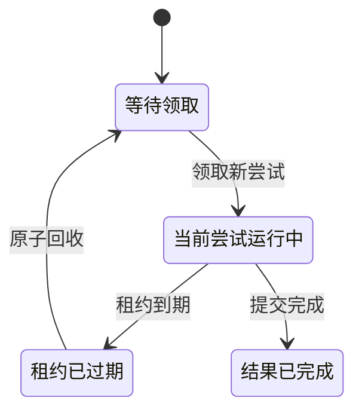

# 代码质量与工程可靠性修复记录

日期：2026-11-23。状态：产品修复及本地适用验证完成；保留旧运行时兼容问题，不作为上线验收。

范围仅为代码质量、业务一致性和工程验证，不涉及网安。基准为 `86144a18405160bc176ee4dfe2c3fc62ededce63`，修改位于独立克隆 `tmp/github-quality-review-20261123`，未改动其他工作副本。用户授权使用子 Agent 实施，并在本地验证后授权提交到 GitHub；下述未提交记录描述验证时状态，实际提交以包含本报告的 Git 提交为准。没有部署。

## 已实施

| 审查问题 | 处理 |
| --- | --- |
| 非法部分更新成功落盘 | 明确部分更新 DTO；合并独立候选后完整校验；持久化入口重新校验 |
| 更新目标丢失图入边 | 条目 upsert 与删除分离；重建清空旧图，验证增量与重建一致 |
| 旧任务执行覆盖新尝试 | 所有执行态变更绑定 attempt 和有效租约；本地提交受同一写锁保护；心跳失效阻止继续提交 |
| 常驻 worker 不持续回收 | 轮询周期回收；锁内重新判断租约、状态和尝试编号，防止旧扫描覆盖新心跳 |
| 重复审核累计批准 | 按内容版本、审核轮次及不同 reviewer 最新意见计数；CLI/HTTP 共用服务；持久化发布回执支持重试 |
| 交互等待期间草稿被替换 | 展示前锁内获取内容摘要与轮次，批准/丢弃在写锁内核对同一快照；变化时拒绝并要求重新审核 |
| CI 质量结果失真 | 固定 Poetry 2.4.1，按锁安装；Black/mypy 独立阻断；保留测试真实非零退出码 |
| 核心类型覆盖不足 | 移除 storage/http_server/ingestion_jobs/job_worker/worker_service 的全模块忽略；其余 25 模块仍是已知债务 |
| Windows 子进程解码异常 | 调用双方显式 UTF-8；未处理线程异常作为测试失败 |

保留文件型单节点架构。旧任务缺少租约时先明确恢复，再重新领取；已完成任务拒绝恢复和迟到失败。旧审核意见可以读取，未绑定当前版本的意见不计入新批准。没有新增自动重试次数上限，也不承诺外部提取调用恰好一次。

## 当前证据

本报告提到的根目录日志、`tmp/` 与 `test-results/` 为本地验证证据，不随产品提交上传；结果摘要与可复跑脚本随仓库保留。

Windows 环境仅为 **audit-only-windows**。主要回归解释器 Python 3.12.8，Poetry 2.4.1，依赖来自未修改的 `poetry.lock`。

| 检查 | 真实结果 | 证据 |
| --- | --- | --- |
| 原始快照锁定环境基线 | 869 passed，13 warnings，退出 0 | 根目录 `review-pristine-baseline.log` |
| 当前全套 pytest | 904 passed，10 warnings，但退出 **-1073741819 / 0xC0000005**，整轮失败 | `review-final-pytest.log`；`test-results/code-quality-remediation-junit.xml` |
| Python 3.12.13 完整回归 | 最终快照 908 passed，10 warnings，退出 0；未跳过测试 | `review-final-python312-confirm.log`；`test-results/python312-confirm-junit.xml`；`test-results/python312-confirm.exit.txt` |
| 最低版本 Python 3.10.20 完整回归 | 最终快照 908 passed，13 warnings，退出 0 | `review-final-python310.log`；`test-results/python310-junit.xml` |
| Black check | 134 文件无需修改，退出 0 | `review-final-format.log` |
| mypy src | 61 源文件，无报告错误，退出 0；受既有忽略清单限制 | `review-final-mypy.log` |
| poetry check --lock | 退出 0，保留元数据弃用提示 | `review-final-lock.log` |
| 干净 wheel 构建/安装/真实 CLI | 退出 0，报告 ok=true | `review-final-wheel.log` |
| 最终代码 wheel 构建/干净安装/真实 CLI | 退出 0，ok=true；使用具备 pip 的 3.12.8 构建工具环境，安装和 CLI 均在新环境 | `review-wheel-final-locked-runtime.log`；`test-results/wheel-final-locked-runtime.exit.txt` |
| Python 3.12.13 官方 PyPI 分发安装对照 | 构建、干净安装、真实 CLI 均通过，退出 0；resolver 安装与锁定回归分别验证 | `review-wheel-final-pypi.log`；`test-results/wheel-final-pypi.exit.txt` |
| 真实审核重试、检索、图关系及恢复演练 | 退出 0，ok=true | `review-final-behavior.log`；`test-results/engineering-behavior-final/report.json` |
| 示例语料检索演练 | 退出 0，4 个用例；3 个正例 recall/MRR/nDCG=1，不能推导实际业务语料质量 | `review-final-retrieval.log`；`test-results/final-retrieval-quality.json` |
| 示例副本备份恢复演练 | 退出 0，恢复后文件、模块、索引与检索检查 | `review-final-restore.log`；`tmp/final-restore-drill/restore-verify-deployment.json` |
| git diff --check | 退出 0 | 最终检查命令输出 |

旧 Python 3.12.8 的失败不能以 XML 或通过数改判成功。六文件最终组合另有 463 passed 后崩溃；`pytest.main()` 返回 0、显式 gc.collect() 返回 0，解释器最终 GC 仍访问冲突；PYTHONMALLOC=debug 和 -X dev 未定位具体组件。诊断见 `tmp/native-diagnosis.md`、`review-native-explicit-gc.log`。隔离 Python 3.12.13 使用相同锁文件作对照，最终完整 908 项测试退出 0；不能将解释器补丁版本/发行版对照成功直接当作具体根因证明。

交互审核版本竞态已通过真实 Prompt 回归：内容变更/同内容新轮次 × 批准/丢弃，修复前 4 failed，修复后 CLI 审核 24 passed/退出 0。Python 3.10 全套包含这四项，未排除测试。

## 有界并发检查

`verification/ingestion/Attempts.tla` 将写锁内操作作为原子动作：一个任务、最多两次执行、布尔租约，假设 worker 持续运行且扫描/回收公平调度。TLC 1.7.4 检查 23 个状态、37 步，四个规则成立，退出 0：类型、当前尝试提交、完成终态不倒退、过期后最终离开 running。



图省略 22 个不改变展示状态的内部步骤。配置显式关闭 deadlock 检查：达到两次尝试上界的 queued 状态可停住，因此不能声称已经证明系统无死锁。模型不覆盖外部服务调用恰好一次、多文件崩溃事务、任意规模、无限重试下最终成功，也不能替代真实多进程测试。源码对应基线为 pending-uncommitted，比较点是上述 HEAD，不能将未提交代码标记为已同步提交。

模型负控分别破坏执行归属、持续恢复及终态保护，三项均返回 1，驱动返回 0。反例分别为：领取→过期→扫描→回收→再领取→旧提交；领取→提交→过期→扫描→停留过期；领取→提交→完成→迟到失败。证据在 `test-results/ingestion-model/` 和 `review-model-controls.log`。最终模型重跑退出 0，见 `review-final-model.log` 和 `test-results/ingestion-model/final-1123/`。

真实源码负控在一次性副本中运行，已核对实际导入路径：原代码执行过期→接管→旧尝试操作回归，1 passed/退出 0；仅删除 `_require_attempt` 的尝试编号比较后，同测试 1 failed/退出 1，明确报告未抛出 JobClaimConflict。共享源码未修改。证据为 `test-results/attempt-source-mutation/summary.json` 及原版/突变日志，其中包含源码哈希和命令。持续恢复和终态反例另由真实 worker/reliability 回归覆盖，不据此声称所有实现突变都已检测。

复跑通过项目技能 `.agents/skills/verify-ingestion-model/SKILL.md` 调用 `$statechart`，以 `verification/ingestion/Attempts.tla --view verification/ingestion/view.mjs --out <新的证据目录>` 执行，运行时按 `$statechart` 当前主机配置解析。真实行为入口为 `.agents/skills/verify-engineering-behavior/SKILL.md`，不需要外部 LLM 服务，恢复演练采用确定的故障注入。

## 未决与交接

- Python 3.12.8 的解释器最终清理崩溃仍未定位到具体组件，保留真实失败；不承诺该旧环境可用。
- Python 3.10.20 锁定安装及完整回归退出 0；Python 3.12.13 最终完整回归退出 0。远端 Ubuntu CI 未运行，分支保护未核验。
- 10 条第三方 TestClient timeout 弃用提示尚存。
- 未运行完整 XS/S/M 性能矩阵；局部性能测试不代表整体容量或上线验收。
- 未提交、推送或部署，不宣称达到上线条件。

## 最终快照与复跑

产品代码最后变更为交互审核快照核对。其后 Black 134 文件、mypy 61 文件、锁文件及 diff 检查均退出 0，见 `test-results/final-quality-exits.txt`；公开分发目录检查 `python -B tools/check_public_surface.py` 退出 0，见 `review-final-public-surface.log`。

完整回归命令分别为：

```text
tmp/py310-env/Scripts/python.exe -X faulthandler -m pytest -q --basetemp=tmp/final-python310 --junitxml=test-results/python310-junit.xml
tmp/py312-current-env/Scripts/python.exe -X faulthandler -m pytest -q --basetemp=tmp/final-python312-confirm --junitxml=test-results/python312-confirm-junit.xml
```

两个环境均由 Poetry 2.4.1 使用相同锁文件安装，不以浮动安装替代锁定回归。锁文件 SHA256 为 `bfcc8d0a63b9464ecc9171ea79c1365dcfb055934dcbb57257e619f891b75c1c`，没有依赖升级。3.12.13 采用隔离发行版，对照同时改变补丁版本和发行方式，只能说明该验证环境没有复现崩溃，不能证明 3.12.8 的具体根因。

真实行为最终复跑：`tmp/py312-current-env/Scripts/python.exe scripts/verify_engineering_behavior.py --output-dir test-results/engineering-behavior-final-snapshot`，退出 0。最终 wheel 首次因 uv 空环境没有 pip 退出 1（`review-wheel-final-snapshot.log`），在该隔离环境执行 ensurepip 补齐构建工具后 wheel 构建成功，但镜像下载依赖超时，整体仍退出 1（`review-wheel-final-confirm.log`）。使用原锁定环境的现成构建工具对同一最终源码执行 `.venv/Scripts/python.exe scripts/verify_install_smoke.py`，构建、干净安装及真实 CLI 全部通过，整体退出 0，见 `review-wheel-final-locked-runtime.log`。不更改项目源码或锁文件来绕过失败。

最终文件哈希与工作差异保存在 `test-results/final-snapshot.json`、`test-results/final-working-diff.patch`。HEAD 只是比较基准，不能代替这些未提交改动。所有本地证据仍属 audit-only-windows，远端 Ubuntu 运行和完整容量矩阵不在已验证结论内。

镜像超时的对照重试已结束：仅在该次验证进程设置 PIP_INDEX_URL 为官方 PyPI，使用 Python 3.12.13 执行相同安装脚本，最终 ok=true、退出 0。原镜像失败记录保留，不修改仓库依赖源或锁文件。
